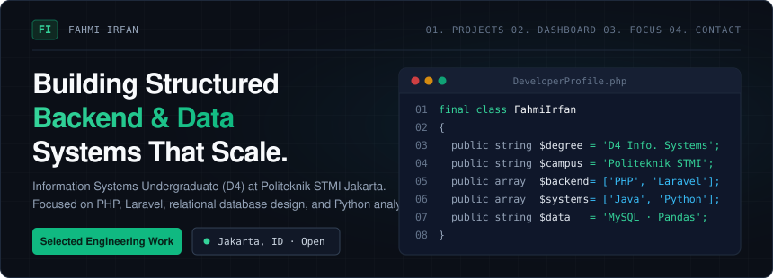
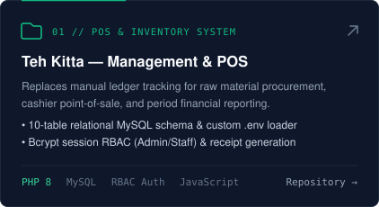
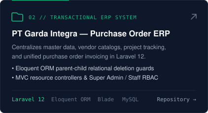
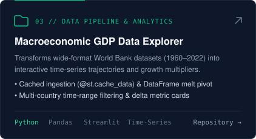
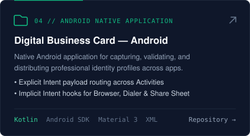
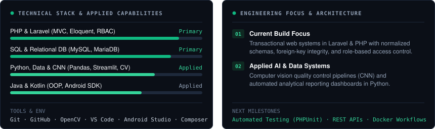

  

### Featured Engineering Work

  
  

  
  

### Engineering Dashboard & Technical Stack

  

  
  

### Repository Index & Verification

| System | Architecture & Engineering Scope | Stack |
|---|---|---|
| **[tehkitta-ikm](https://github.com/Yukomyy/tehkitta-ikm)** | 10-table relational POS, raw material procurement, custom `.env` loader, Bcrypt RBAC, and period financial reporting. | `PHP 8` `MySQL` `JS` |
| **[tugasBesarPemrogramanBasisWeb](https://github.com/04Keishi/tugasBesarPemrogramanBasisWeb)** | Enterprise master data & unified Purchase Order/Invoice workflow with Eloquent parent-child deletion constraints. | `Laravel 12` `MySQL` |
| **[gdp-dashboard](https://github.com/Yukomyy/gdp-dashboard)** | Cached World Bank dataset pipeline (`@st.cache_data`), DataFrame `melt` unpivoting, and time-series growth metrics. | `Python` `Pandas` `Streamlit` |
| **[pemrograman-aplikasi-bergerak-p3](https://github.com/Yukomyy/pemrograman-aplikasi-bergerak-p3)** | Native Android contact card router using Explicit & Implicit Intents (Browser, Dialer, Share Sheet). | `Kotlin` `Android SDK` |

---

  <b>Fahmi Irfan</b> &nbsp;·&nbsp; D4 Sistem Informasi, Politeknik STMI Jakarta &nbsp;·&nbsp; <a href="mailto:fhmiirfn2006@gmail.com">fhmiirfn2006@gmail.com</a> &nbsp;·&nbsp; <a href="https://github.com/Yukomyy">github.com/Yukomyy</a>

