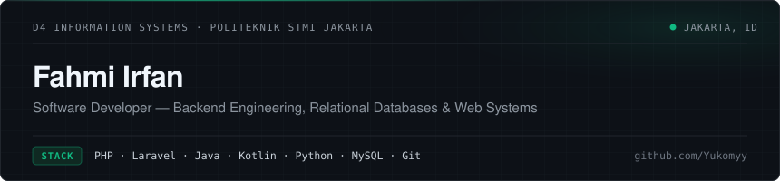
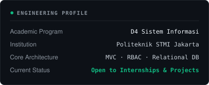
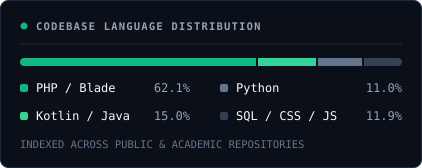

  

  Information Systems undergraduate (D4) at <b>Politeknik STMI Jakarta</b> building transactional web applications, relational database schemas, and data-driven dashboards. My work centers on backend development with PHP and Laravel, object-oriented programming in Java and Kotlin, and structured data processing using Python and SQL.

  <a href="#featured-projects">Featured Projects</a> &nbsp;·&nbsp;
  <a href="#technical-expertise">Technical Expertise</a> &nbsp;·&nbsp;
  <a href="#engineering-focus">Engineering Focus</a> &nbsp;·&nbsp;
  <a href="#telemetry--repository-metrics">Metrics</a> &nbsp;·&nbsp;
  <a href="#contact">Contact</a>

---

<h3 id="featured-projects">Featured Projects</h3>

<table>
  <tr>
    <td width="50%" valign="top">
      <h4>01 &nbsp;·&nbsp; <a href="https://github.com/Yukomyy/tehkitta-ikm">Teh Kitta — Management &amp; POS System</a></h4>
      
Web-based Point of Sale (POS), raw material procurement, and financial reporting platform built for small-and-medium beverage enterprise operations (PT Rafika Mandiri).

      <ul>
        <li><b>Problem Solved:</b> Replaces manual ledger tracking across raw material purchasing, daily cashier sales, and periodic revenue reconciliation.</li>
        <li><b>Engineering Scope:</b> Designed a 10-table relational MySQL schema, built a custom <code>.env</code> configuration loader, implemented Bcrypt session-based RBAC (<code>Admin</code> &amp; <code>Staff</code>), and created printable receipt and period report views.</li>
        <li><b>Stack:</b> <code>PHP 8</code> <code>MySQL</code> <code>JavaScript</code> <code>CSS3</code></li>
      </ul>
      
<a href="https://github.com/Yukomyy/tehkitta-ikm">View Repository →</a>

    </td>
    <td width="50%" valign="top">
      <h4>02 &nbsp;·&nbsp; <a href="https://github.com/04Keishi/tugasBesarPemrogramanBasisWeb">PT Garda Integra Solusindo — ERP &amp; PO System</a></h4>
      
Collaborative transactional management system developed with Laravel 12 to centralize master data and purchase order workflows.

      <ul>
        <li><b>Problem Solved:</b> Prevents orphaned transactional records and streamlines multi-vendor product catalog and purchase order invoicing.</li>
        <li><b>Engineering Scope:</b> Implemented MVC resource controllers, Eloquent ORM relationships with strict parent-child deletion constraints, unified Purchase Order &amp; Invoice workflows, and role-based permissions for Super Admin and Staff.</li>
        <li><b>Stack:</b> <code>Laravel 12</code> <code>PHP</code> <code>Eloquent ORM</code> <code>Blade</code> <code>MySQL</code></li>
      </ul>
      
<a href="https://github.com/04Keishi/tugasBesarPemrogramanBasisWeb">View Repository →</a>

    </td>
  </tr>
  <tr>
    <td width="50%" valign="top">
      <h4>03 &nbsp;·&nbsp; <a href="https://github.com/Yukomyy/gdp-dashboard">Macroeconomic GDP Data Explorer</a></h4>
      
Interactive time-series analytics web application for exploring historical World Bank Gross Domestic Product (GDP) datasets (1960–2022).

      <ul>
        <li><b>Problem Solved:</b> Transforms wide-format multi-decade CSV datasets into normalized, filterable time-series visualizations and growth multipliers.</li>
        <li><b>Engineering Scope:</b> Built a cached ingestion pipeline (<code>@st.cache_data</code>) using Pandas DataFrame unpivoting (<code>melt</code>), dynamic year-range sliders, multi-country comparison charts, and period-over-period delta calculation cards.</li>
        <li><b>Stack:</b> <code>Python</code> <code>Streamlit</code> <code>Pandas</code></li>
      </ul>
      
<a href="https://github.com/Yukomyy/gdp-dashboard">View Repository →</a>

    </td>
    <td width="50%" valign="top">
      <h4>04 &nbsp;·&nbsp; <a href="https://github.com/Yukomyy/pemrograman-aplikasi-bergerak-p3">Digital Business Card — Android Application</a></h4>
      
Native Android application demonstrating structured activity navigation, form validation, and system-level intent integration.

      <ul>
        <li><b>Problem Solved:</b> Provides a structured mobile interface for capturing, validating, previewing, and sharing professional contact profiles across device apps.</li>
        <li><b>Engineering Scope:</b> Implemented <code>MainActivity</code> to <code>ProfileActivity</code> payload routing via Explicit Intents and integrated browser, phone dialer, and native Android Share Sheet actions via Implicit Intents.</li>
        <li><b>Stack:</b> <code>Kotlin</code> <code>Android SDK (API 24+)</code> <code>Material Design 3</code> <code>XML</code></li>
      </ul>
      
<a href="https://github.com/Yukomyy/pemrograman-aplikasi-bergerak-p3">View Repository →</a>

    </td>
  </tr>
</table>

---

<h3 id="technical-expertise">Technical Expertise</h3>

| Category | Technologies & Applied Capabilities |
|---|---|
| **Programming Languages** | `PHP` `Java` `Kotlin` `Python` `SQL` `JavaScript` `HTML5` `CSS3` |
| **Backend Development** | `Laravel 12` `MVC Architecture` `Native PHP Modular` `Eloquent ORM` `Session Auth & RBAC` `Form Request Validation` |
| **Frontend & Mobile** | `Blade Templates` `Android SDK` `Material Design 3` `Responsive CSS Grid & Flexbox` `DOM Manipulation` |
| **Database & Data** | `MySQL` `MariaDB` `Relational Schema Design` `Foreign Key Integrity` `Pandas` `Streamlit` |
| **Development Tools** | `Git` `GitHub` `Android Studio` `Visual Studio Code` `Composer` `XAMPP / Laragon` `Linux` |

---

<h3 id="engineering-focus">Engineering Focus</h3>

- **Current Development:** Building full-stack transactional information systems with **Laravel** and **PHP**, focusing on clean database normalization, role-based access control, and maintainable MVC structure.
- **Technical Exploration:** Deepening object-oriented design patterns in **Java** and **Kotlin**, alongside automated data transformation and analytical reporting in **Python**.
- **Next Milestones:** Expanding automated testing coverage (PHPUnit / Pest), RESTful API design with token authentication, and containerized local development workflows.

---

<h3 id="telemetry--repository-metrics">Telemetry &amp; Repository Metrics</h3>

  
  

---

<h3 id="contact">Contact &amp; Verification</h3>

- **Email:** [fhmiirfn2006@gmail.com](mailto:fhmiirfn2006@gmail.com)
- **GitHub:** [github.com/Yukomyy](https://github.com/Yukomyy)
- **Institution:** Politeknik STMI Jakarta — D4 Sistem Informasi
